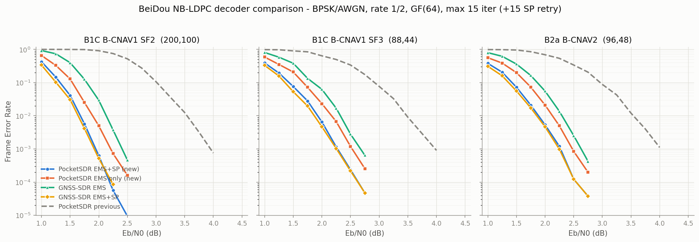
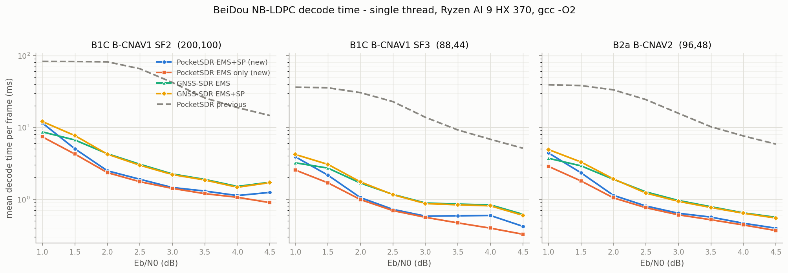

# NB-LDPC Decoder Evaluation and Redesign

Date: 2026-10-26

----

## Summary

The PocketSDR NB-LDPC decoder `sdr_decode_NB_LDPC()` (`src/sdr_nb_ldpc.c`)
was benchmarked against the GF(64) NB-LDPC decoder introduced in GNSS-SDR
v0.0.22 (`beidou_ldpc.cc`) on the BeiDou B1C/B2a codes, with identical
H-matrices, an ICD-derived GF(64) encoder, and paired BPSK/AWGN frames. The
previous implementation (EMS with NM = 4 and an accumulated, non-extrinsic
posterior) lost 1.6-1.9 dB to GNSS-SDR's production configuration at
FER = 1e-2, miscorrected (parity-satisfying wrong codeword) in 1-5 % of its
frame errors, and was 10-20x slower per frame.

The decoder internals were redesigned and reimplemented: extrinsic EMS with
NM = 8 truncated messages and a compensation offset, input LLR scale
normalization, a cached Tanner graph, a layered (per-check) update
schedule, and a full-alphabet sum-product retry on EMS failure. The public
API is unchanged. Measured after the redesign:

- Error-correction: 1.6-1.9 dB better than the previous code; the measured
  thresholds sit within 0.02-0.06 dB of GNSS-SDR's EMS + sum-product
  production configuration, below the ~0.05 dB resolution of these runs
  (statistically indistinguishable). The EMS stage alone measures
  0.15-0.25 dB better than GNSS-SDR's EMS at the same 15 iterations; the
  sum-product retry adds 0.21-0.26 dB.
- Miscorrections: reduced to the GNSS-SDR level in these runs (1-2 per
  1.06e5 frames at a few near-threshold points, none observed elsewhere).
- Speed (single thread): 7-17x faster than the previous code and
  1.05-1.4x faster than GNSS-SDR in the same configuration at every
  operating point; the sum-product retry only runs on EMS failures, so it
  costs nothing where frames decode.

## Evaluation Setup

Codes under test (all GF(2^6), p(x) = x^6 + x + 1, row weight 4, rate 1/2):

| code | signal | (n, k) symbols | code bits |
|------|--------|----------------|-----------|
| BCNV1_SF2 | B1C B-CNAV1 subframe 2 | (200, 100) | 1200 |
| BCNV1_SF3 | B1C B-CNAV1 subframe 3 | (88, 44) | 528 |
| BCNV2 | B2a B-CNAV2 frame | (96, 48) | 576 |

B2b (BCNV3, (162,81)) uses the same PocketSDR decoder but is excluded from
the head-to-head FER runs because the GNSS-SDR graph builder requires the
check count to be a multiple of the row weight (81 % 4 != 0); GNSS-SDR
v0.0.22 does not support B2b. The redesigned decoder keeps full B2b support
(verified by noiseless round trip and symbol-error injection).

Method:

- The H-matrix tables of both implementations were machine-extracted and
  compared: identical entry-by-entry for all three codes, so the comparison
  is purely between decoder algorithms.
- Encoder: GF(64) systematic encoding from the ICD H-matrix, parity symbols
  solved with a precomputed inverse of the parity-column submatrix; every
  generated codeword verified against the syndrome.
- Channel: BPSK + AWGN. Eb/N0 refers to information bits (rate 1/2), i.e.
  sigma^2 = 1 / (2 R Eb/N0).
- Inputs: GNSS-SDR receives calibrated float bit LLRs L = 2y/sigma^2 (the
  scale its EMS offset is tuned for). PocketSDR receives the same LLRs
  mapped to its `uint8_t` soft symbols by
  sym = clip(round(127.5 + L * 255 / (2 ln 1e5)), 0, 255), the exact
  inverse of the previous decoder's fixed `init_LLR_soft()` scale
  (quantization effects negligible at these SNRs; the new decoder
  re-normalizes internally).
- Iteration budget: 15 for all EMS decoders. "EMS+SP" additionally runs the
  GNSS-SDR full-alphabet sum-product for up to 15 more iterations when EMS
  fails; this is how GNSS-SDR calls the decoder in production
  (`enable_sum_product = true`).
- Statistics per point: Eb/N0 grid 1.00-5.00 dB, step 0.25, with per-code
  early stop; per point, each decoder runs until 100 frame errors or
  1.06e5 frames. Frames are generated from a deterministic per-frame seed
  (code, Eb/N0, frame index), so every decoder sees identical noise and
  runs are reproducible. Single-thread timing on a Ryzen AI 9 HX 370,
  gcc 13 -O2 (MSYS2 UCRT64), fixed 300/1000 frames per point.

The benchmark harness (encoder, channel, both decoders, comparison
variants, plot scripts) is in `test/ldpc_cmp/` with the raw result CSVs of
all runs under `test/ldpc_cmp/results/` (see its README.md for the column
meanings and run commands). The GPL-3.0 GNSS-SDR sources are not stored in
the repository; `make fetch` downloads them pinned to commit
`3fcb502aeb618968cd24492010fb8186f122efda` (main, after v0.0.22,
2026-10-26). The "previous" decoder is `src/sdr_nb_ldpc.c` at commit
`a68c2d4`.

## Previous Implementation: Results and Root Cause

The previous `sdr_decode_NB_LDPC()` differed from the EMS of the B1C ICD
Annex / the EMS literature in two coupled ways:

1. Truncation without compensation. The check-node `ext_min_sum()` kept
   the NM = 4 most reliable entries of each operand and saturated all other
   field elements at `L1[idx1[NM-1]] + L2[idx2[NM-1]]`, with no additive
   offset for the discarded mass.
2. Non-extrinsic accumulated posterior. The per-symbol LLR `L[]` was never
   reset to the channel LLR: every iteration added all incoming C2V
   messages into it, and the variable-node update built V2C messages on top
   of this accumulated `L[]`, so a node's own output was fed back to it in
   later iterations.

Diagnostic variants showed that neither element can be changed in
isolation: raising NM to 8 with the accumulation kept gained only ~0.1 dB,
while removing the accumulation (textbook extrinsic schedule) with NM = 4
kept collapsed the decoder entirely - without a compensation offset the
truncated messages are too weak to converge, and the accumulation is what
rescued them, at the cost of overconfident convergence (miscorrections in
1-5 % of frame errors) and a 1.2-1.5 dB loss against GNSS-SDR's EMS. The
cost gap (10-20x) came from O(ne^2) edge-pair scans in both node updates,
O(Q^2) bubble-sort `argsort()` calls inside `ext_min_sum()`, and ~1000
small allocations plus Tanner-edge rebuilding per decode call.

Measured FER thresholds of the previous code are in the tables below
("previous" column) and in the figures.

## Redesigned Decoder

Implemented in `src/sdr_nb_ldpc.c` (2026-10-26); the public API
`sdr_decode_NB_LDPC(H_idx, H_ele, m, n, syms, syms_dec)` and the caller
side (`sdr_ldpc.c`, `sdr_nav.c`) are unchanged. Written from the
specifications and papers in the references; GNSS-SDR was used only as a
black-box benchmark reference.

### Algorithm

1. Graph construction and cache. A check-major edge table (variable index,
   h_ij, h_ij^-1 per edge) plus a variable-major edge list is built once
   per H-table and cached in a small static table keyed by the `H_idx`
   pointer. Receiver channels run in separate threads (`ch_thread()` in
   `sdr_rcv.c`), so the GF-table and cache initialization is guarded by a
   static mutex; after construction the graph is immutable and decoding
   uses only per-call state. Per-call workspace of the EMS stage is a
   single allocation; the sum-product retry, when it runs, makes two more.
2. Channel LLR initialization with scale normalization. The 64-entry
   channel metric per GF(64) symbol is built from the 6 bit LLRs relative
   to the hard-decision symbol. Because the compensation offset is not
   scale-invariant while the receiver's soft symbols are not noise-
   calibrated (`corr2soft()` uses a fixed `SOFT_SCALE`), the input scale is
   estimated from the symbols themselves (mean |sym - 127.5|) and bit LLRs
   are normalized to a fixed mean |LLR| = `LLR_AVE` before decoding. The
   sum-product retry uses the same normalized scale, so it is not exactly
   channel-matched: the fixed target stands in for the true 2y/sigma^2
   scale, which it approximates within ~+/-40 % over the 1.0-4.5 dB
   waterfall region (and the EMS stage is scale-invariant apart from the
   offset). Measured impact: none resolvable - see the input-scale
   robustness results below. A moment-based estimate of the channel scale
   (amplitude/sigma from the symbol statistics) is a possible refinement
   if a measurable gap ever shows up.
3. Messages. A message is a list of the NM = 8 most reliable
   (symbol, LLR) pairs, sorted ascending and normalized to llr[0] = 0,
   kept in the edge domain y = h_ij * x_j so check nodes need only GF
   additions. Truncation from a 64-entry metric is a single insertion pass;
   the elementary check-node combine takes the NM x NM candidate pairs,
   minimizes per field element in a 64-entry scratch array and re-truncates
   (O(NM^2 + Q), exact for the kept set).
4. Layered (per-check) schedule. The decoder keeps one posterior LLR
   vector per variable plus the last expanded C2V contribution per edge.
   For each check per iteration: extrinsic V2C messages are formed by
   subtracting the edge's own C2V contribution from the posterior, the
   CN->VN messages are computed by forward-backward recursion (6 elementary
   combines for dc = 4), and the posteriors of the participating variables
   are updated immediately, with elements missing from a truncated message
   filled at `llr[NM-1] + EMS_OFFSET`. Hard decisions come from the
   posteriors; the syndrome is checked after every iteration.
5. Sum-product retry. If EMS has not converged after `MAX_ITER`
   iterations, the frame is re-decoded from the channel LLRs with the exact
   full-alphabet sum-product algorithm in the probability domain (double),
   up to `MAX_ITER_SP` more iterations: check nodes compute the GF(2^6)
   XOR convolution as an element-wise product in the Walsh-Hadamard domain
   (self-inverse 64-point transform, 6 butterfly stages), variable nodes
   take leave-one-out products of the channel probabilities and incoming
   messages, and every message is floored at 1e-15 *relative to its
   largest element* and renormalized. The relative floor keeps the
   operation scale-invariant: unnormalized leave-one-out products can have
   maxima far below any absolute floor (a confident channel contradicted
   by confident checks), where an absolute floor would erase the valid
   relative probabilities. It also absorbs the inverse-transform roundoff
   negatives and prevents hard zeros from locking a symbol.

The layered schedule replaced the flooding schedule of the original design
for two reasons, one measured and one specific:

- On the ICD matrices, the layered decoder measures 0.15-0.25 dB better
  than a flooding prototype of the same EMS at the same 15 iterations
  (the flooding prototype landed at GNSS-SDR's EMS level), consistent
  with layered schedules converging in roughly half the iterations.
- The unit-test H in `test/src/test_sdr_nb_ldpc.c` places the same
  variable three times in one row, so its Tanner graph has parallel edges
  (unlike the ICD matrices). On that degenerate graph with
  equal-confidence inputs, the flooding prototype oscillates with
  period 2 and never converges, while the layered schedule converges in
  2 iterations. This is an observation on that specific graph, kept
  covered by the unit test; it is not the basis of the FER claims above.

### Parameters

| name | value | note |
|------|-------|------|
| NM_EMS | 8 | truncation width |
| EMS_OFFSET | 2.0 | compensation offset; simulation optimum on the (200,100) code at 2.0-2.5 dB (grid 0.5, re-tuned after the layered change) |
| LLR_AVE | 4.0 | normalization target of mean input bit \|LLR\| |
| MAX_ITER | 15 | unchanged |
| MAX_ITER_SP | 15 | sum-product retry iterations (0 disables the retry) |

`EMS_OFFSET`, `LLR_AVE` and `MAX_ITER_SP` carry `#ifndef` guards for tuning
builds.

## Results After the Redesign

Eb/N0 (dB) required to reach a target FER (log-interpolated; "new" = the
redesigned decoder EMS+SP as shipped, "new EMS" = the same with
`MAX_ITER_SP = 0`, "previous" = NM = 4 accumulated decoder, "ems"/"sp" =
GNSS-SDR EMS only / EMS+SP production configuration):

| code | FER | new | new EMS | previous | ems | sp | new-previous | new-sp |
|------|-----|------|---------|----------|------|------|--------------|--------|
| BCNV1_SF2 | 1e-2 | 1.68 | 1.89 | 3.54 | 2.13 | 1.64 | -1.86 | +0.04 |
| BCNV1_SF2 | 1e-3 | 1.95 | 2.21 | 3.95 | 2.41 | 1.92 | -2.00 | +0.03 |
| BCNV1_SF3 | 1e-2 | 1.93 | 2.17 | 3.48 | 2.32 | 1.87 | -1.55 | +0.06 |
| BCNV1_SF3 | 1e-3 | 2.27 | 2.53 | 3.98 | 2.67 | 2.25 | -1.71 | +0.02 |
| BCNV2 | 1e-2 | 1.89 | 2.13 | 3.54 | 2.30 | 1.85 | -1.65 | +0.04 |
| BCNV2 | 1e-3 | 2.27 | 2.48 | ~4.0 | 2.63 | 2.25 | ~-1.7 | +0.02 |

The EMS stage alone measures 0.15-0.25 dB better than GNSS-SDR's EMS at
the same 15-iteration budget (the layered schedule converges further
within the budget); the sum-product retry adds another 0.21-0.26 dB,
landing within 0.02-0.06 dB of the GNSS-SDR production configuration at
every measured point. Statistical resolution: with the 100-error stopping
rule the 95 % confidence interval of a FER point is roughly +/-20 %, which
maps through the waterfall slopes (0.3-0.4 dB per decade) to about
+/-0.03-0.05 dB on an interpolated threshold - so the "new" vs "sp"
differences are below the resolution of these runs and the two are
statistically indistinguishable here, while the 0.15-0.25 dB EMS-stage
margin and all larger gaps are well resolved. Per-frame decisions were not
recorded, so paired discordance counts are not available; all decoders did
see identical noise frames.

Miscorrections dropped to the GNSS-SDR level in these runs: one or two per
1.06e5 frames at a handful of near-threshold points - the same points and
comparable counts as GNSS-SDR's sum-product (frame identity not recorded) -
and none observed elsewhere (zero observations bound the rate to below
~3e-5 at 95 % for the 1.06e5-frame points, not zero), vs 1-5 % of frame
errors for the previous code. Both receivers still validate frames by
CRC-24 downstream.

Mean decode time per frame (ms, single thread):

| code | condition | new | new EMS | previous | ems | sp |
|------|-----------|------|---------|----------|------|------|
| BCNV1_SF2 | full-iteration failure ceiling (~1.0 dB) | 11.5 | 7.4 | 82.7 | 8.6 | 12.0 |
| BCNV1_SF2 | 4.0 dB (essentially all success) | 1.12 | 1.06 | 18.8 | 1.51 | 1.47 |
| BCNV1_SF2 | noiseless (parity passes at init) | 0.002 | 0.002 | 0.07 | 0.03 | 0.03 |
| BCNV1_SF3 | 4.0 dB | 0.59 | 0.40 | 6.8 | 0.83 | 0.81 |
| BCNV2 | 4.0 dB | 0.46 | 0.44 | 7.6 | 0.65 | 0.64 |

The "new"/"ems"/"sp" columns are one session (speed_v022_spretry.csv), the
"new EMS" and "previous" columns are earlier sessions; single-thread
sessions vary by ~20-30 % at this level (e.g. BCNV1_SF3 at 4.0 dB measured
0.41 ms for "new" in the previous session), so compare within a session
and read cross-session ratios coarsely. Within the session, the new
decoder is 7-17x faster than the previous code and 1.05-1.4x faster than
GNSS-SDR in the same configuration at every operating point. The
sum-product retry only runs on EMS failures, so above threshold (FER below
a few %) its average cost is negligible; even at FER ~ 1 it adds ~50 %
(and remains below GNSS-SDR's EMS+SP, whose EMS stage fails more often
and hands more frames to the retry).

### Input-scale robustness

The decoder sees uint8 soft symbols whose gain depends on signal level and
front-end settings. `gain_test.cpp` sweeps that gain at a fixed channel
(BCNV1_SF2 at 1.75 dB, BCNV1_SF3 at 2.00 dB, 20000 frames per point;
gain 1 corresponds to mean |sym - 127.5| = 36):

| gain | mean \|sym-127.5\| | clip rate | FER EMS+SP (SF2) | FER EMS (SF2) |
|------|------------------|-----------|-----------------|---------------|
| 1/16 | 2.3 | 0 | 1.5e-2 | 5.8e-2 |
| 1/8 | 4.5 | 0 | 7.2e-3 | 3.2e-2 |
| 1/4 - 1 | 9 - 36 | 0 | 5.4e-3 - 5.6e-3 | 2.5e-2 |
| 2 | 69 | 0.13 | 5.9e-3 | 2.6e-2 |
| 4 | 98 | 0.53 | 3.7e-2 | 1.0e-1 |
| 16 | 120 | 0.89 | 8.0e-1 | 9.3e-1 |

The internal normalization holds FER flat over an 8x gain range (1/4 to
2x); SF3 behaves the same. Degradation outside that range comes from the
uint8 interface itself, not the normalization: at very low gain the
quantization becomes coarse (~2 LSB per bit LLR at gain 1/16), at high
gain the symbols saturate toward hard decisions (53 % clipped at gain 4).
The EMS-to-EMS+SP ratio is unchanged across the sweep, so the sum-product
stage is no more sensitive to the fixed normalization than EMS in these
conditions. Practical guidance: keep the soft-symbol scaling such that
mean |sym - 127.5| stays roughly within 5-70.

### Known limitations

- An EMS miscorrection (parity-satisfying wrong codeword, ~1e-5 near
  threshold) bypasses the sum-product retry, since the retry triggers on
  parity failure only; the frame is then lost at the downstream CRC-24. A
  CRC-triggered retry from `sdr_nav.c` could recover a part of these, at
  the cost of caller-side plumbing; at the measured rates (and with the
  sum-product stage itself miscorrecting at a comparable rate) this is not
  currently worth it.
- `EMS_OFFSET` was tuned on BCNV1_SF2 at 2.0-2.5 dB only. The BCNV1_SF3
  and BCNV2 FER curves beating GNSS-SDR's EMS by the same margin indicates
  the value transfers across the (very similar) ICD codes, but it was not
  re-optimized per code, and BCNV3 has no independent reference decoder to
  compare against.

## Verification

- Unit tests: `make -C test/utest test` (MSYS2 UCRT64, GNU make) - all 126
  tests pass, including `test_sdr_nb_ldpc` (empty input, noiseless round
  trip, check/information-symbol correction on the degenerate
  repetition-code H) and `test_sdr_ldpc` (BCNV2 error correction through
  `sdr_decode_LDPC()`).
- Symbol-error injection on the ICD codes: all 1-6 wrong-symbol patterns
  corrected on BCNV1_SF2 and BCNV3 (50 trials each), degrading gracefully
  beyond (BCNV1_SF2 with the sum-product retry: 12 errors 48/50, 14 errors
  47/50).
- `lib/build/libsdr.so`/`libsdr.a` build cleanly (-Wall, no warnings).
- Remaining: receiver-level regression on recorded B1C/B2a/B2b IF data
  (frame success counts, ephemeris/almanac decode, time-to-first-frame),
  and the follow-up port of the same algorithm to `python/sdr_nb_ldpc.py`.

## References

1. BeiDou Navigation Satellite System Signal In Space Interface Control
   Document, Open Service Signal B1C (Version 1.0), December 2017 -
   H-matrices and the EMS decoding algorithm of the Annex.
2. BeiDou ICD Open Service Signal B2a (Version 1.0), December 2017.
3. BeiDou ICD Open Service Signal B2b (Version 1.0), July 2020.
4. A. Voicila, D. Declercq, F. Verdier, M. Fossorier, P. Urard,
   "Low-complexity decoding for non-binary LDPC codes in high order
   fields," IEEE Trans. Communications, vol. 58, no. 5, 2010 - EMS with
   truncated messages and compensation offset.
5. E. Li, D. Declercq, K. Gunnam, "Trellis-based Extended Min-Sum
   algorithm for non-binary LDPC codes and its hardware structure," IEEE
   Trans. Communications, 2013.
6. D. Declercq, M. Fossorier, "Decoding algorithms for nonbinary LDPC
   codes over GF(q)," IEEE Trans. Communications, vol. 55, no. 4, 2007.
7. GNSS-SDR v0.0.22, `src/core/system_parameters/beidou_ldpc.cc` -
   benchmark reference implementation (GPL-3.0; used as a black box only).
