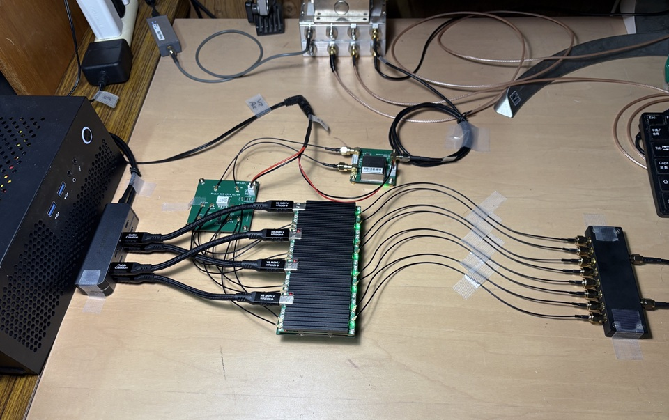
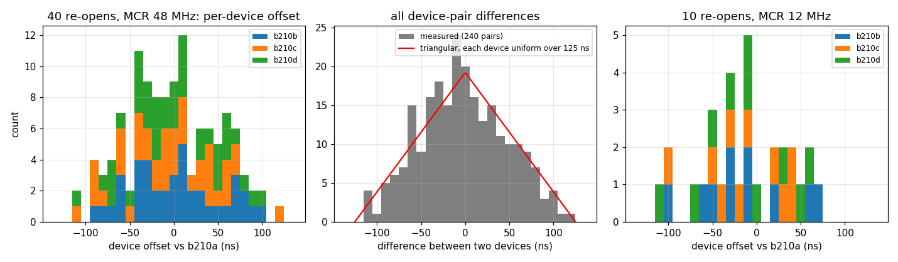
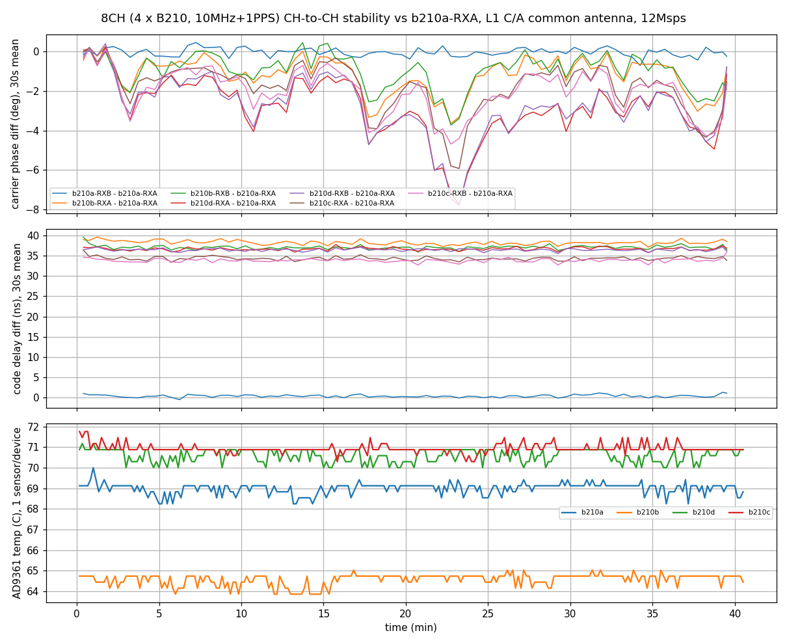

# 複数 USRP B210 の 10 MHz / 1PPS 同期試験

Date: 2026-09-08

----

## 1. 概要

USRP B210 互換機 4 台 (合計 8 RF CH) に共通の 10 MHz 基準クロックと 1PPS を
分配し、PocketSDR の複数デバイス同期入力 (`src/sdr_sdev.c`) で 1 プロセスとして
同時受信したときの、

1. デバイス間のサンプルタイミング差 (サンプルずれ)
2. RF CH 間の搬送波位相コヒーレンシの時間安定性 (AD9361 温度の同時記録)

を実測した。全 RF CH には同一の GNSS アンテナからの信号を 8 分配器経由で
入力しているので、同一衛星を追尾する CH 間の擬似距離差・搬送波位相差は
幾何と衛星時計が相殺し、受信機ハードウェアの差だけが残る。この性質を使い
GNSS 信号そのものを校正信号として用いた。

主な結果:

- 10 MHz + 1PPS による同期起動は 4 台とも正常 (`ref_locked=1`、PPS 時刻一致、
  共通時刻でのタイムドスタート)。8 回の起動と 40 分の連続運転でドロップ・
  オーバフロー・PPS 異常はゼロ。
- デバイス間のサンプルタイミング差は **0 にはならず、起動毎にデバイス単位で
  独立に引き直される連続値** である。再 open 40 回の追加実験 (相互相関法) で、
  各デバイスの値は **幅約 125 ns (12 Msps で 1.5 サンプル) の一様分布** に従う
  (デバイス間の差は ±125 ns の三角分布、標準偏差 51 ns で理論値と一致)。
  グリッド性は無く、master clock rate 48 / 12 MHz で幅は変わらない。走行中は
  ±0.5 ns で一定。同一デバイス内の RXA/RXB 間は固定で 0.5 ns 以内。
- 搬送波位相差は、熱平衡状態で **デバイス間 4〜8° p-p / 40 分**、直線ドリフト
  ≈ 0 (|−0.008| cycle/h 以下)、同一デバイス内は 0.3° p-p。ドリフト波形は
  デバイス単位で一致し、LO / BBPLL に起因する。
- 校正後の位相誤差は約 2 分で 1 デバイスあたり 1.1〜1.4° rms に飽和する。
  CRPA の校正頻度 (開ループのヌル形成) は、抑圧量 20 dB なら起動時 1 回、
  30 dB なら数分毎、40 dB は 30 s 以下となり周期校正では非現実的で、適応
  ヌル形成 + 起動時校正の組合せが現実解になる (5.5 節)。

## 2. 試験構成

### 2.1 ハードウェア

| 項目 | 内容 |
|---|---|
| SDR | USRP B210 互換機 (TinyB210 系クローン、内蔵 GPSDO 付き) × 4 |
| 受信 CH | 各機 RXA / RXB の 2 CH、合計 8 CH |
| 基準クロック | 外部 10 MHz + 1PPS を分配回路で 4 台に供給 (clock/time source = external) |
| アンテナ | 屋上 GNSS アンテナ 1 本 → 8 分配器 → 各 RX 入力 |
| USB 接続 | 2 台を Bus002 (10 Gbps セルフパワーハブ、xHCI #1)、2 台を Bus004 (xHCI #2) の 2+2 分割 |
| ホスト PC | AMD Ryzen 9 7945HX、Ubuntu 24.04.2 LTS (kernel 7.0.0) |
| ドライバ | UHD 4.6.0、SoapySDR 0.8.1 + SoapyUHD |

デバイス名と CH 番号の規約 (`/share/test_usrp.sh` に準拠):

| デバイス | serial | CH (RXA / RXB) |
|---|---|---|
| b210a | 272142 | CH1 / CH2 |
| b210b | 272472 | CH3 / CH4 |
| b210c | 272612 | CH5 / CH6 |
| b210d | 272584 | CH7 / CH8 |

注意: 本試験の起動時は `-driver` の列挙順が 272142; 272472; 272584; 272612
だったため、ログ上の ch5/ch6 が b210d、ch7/ch8 が b210c に対応する。本書の表と
図はデバイス名に読み替えて記載している。今後は a, b, c, d の順
(272142; 272472; 272612; 272584) で起動する。

<br>
<div style="text-align: center;">

</div>

### 2.2 ソフトウェアと受信条件

PocketSDR の複数デバイス同期入力 (`sdr_sdev.c`、SoapySDR API のみ使用)
を用い、1 プロセスの `pocket_trk` で 8 CH を同時受信した。

| 項目 | 内容 |
|---|---|
| サンプリング | 12 Msps、CS16 (ワイヤ形式 sc12)、UHD の master clock rate は自動選択で 48 MHz (デシメーション 4) |
| LO 周波数 | 1575.42 MHz (全 CH) |
| 追尾信号 | GPS L1 C/A、PRN 1〜32 を全 8 CH に割当 (最大 256 追尾 CH) |
| センサ記録 | `-sens temp,lo_locked,ref_locked` により 10 s 周期で `$SENS` ログ |
| ログ | `-log` による `$CH` (1 s 周期、CH ごとの C/N0・コードオフセット・Doppler・ADR 等) |

実行コマンド (連続運転の例):

```
pocket_trk -driver "driver=uhd,serial=272142,nchan=2;driver=uhd,serial=272472,nchan=2;\
driver=uhd,serial=272612,nchan=2;driver=uhd,serial=272584,nchan=2" \
    -fmt CS16 -f 12 -fo 1575.42 -sig L1CA -prn 1-32 -rfch 1-8 -ti 10 \
    -sens temp,lo_locked,ref_locked -log soak.log
```

`-NO_SYNC` を付けないことで同期モード (PPS 整列 + 共通時刻タイムドスタート)
になる。

### 2.3 同期シーケンス (ソフトウェア側)

`sdr_sdev_open()` / `sdr_sdev_start()` は次の手順で全デバイスを同期する。

1. 各デバイスに clock source / time source = external を設定。
2. PPS エッジ待ち: 先頭デバイスの `getHardwareTime("PPS")` が変化するまで待つ
   (タイムアウト 2.5 s、超過時は "no PPS detected" で停止)。
3. 全デバイスに `setHardwareTime(0, "PPS")` を発行 (次の PPS で時刻 0 をラッチ)。
4. 1.2 s 待ってから各デバイスの PPS ラッチ時刻を読み、一致 (許容 1 ms) を検証。
5. 共通の開始時刻 (現在時刻 + 2 s) を全デバイスのストリームに `HAS_TIME` 付きで
   指定してタイムドスタート。
6. 受信側では各パケットのハードウェア時刻 `tns` から絶対サンプル位置を求め、
   CH ごとのリングバッファへ書く (欠落はゼロ埋め、デバイス間の整列はハードウェア
   時刻の関数として保証)。

## 3. 測定方法

### 3.1 デバイス間サンプルタイミング差

同一衛星を追尾している CH k と基準 CH1 (b210a RXA) のコードオフセット差
(`$CH` の coff、1 s 値) を取り、C/A コード周期の ±0.5 ms に折り返して ns に
換算した。条件は C/N0 ≥ 35 dB-Hz、ロック継続 ≥ 5 s、**衛星仰角 ≥ 30°**
(低仰角衛星はマルチパスの影響が大きいため除外)。

仰角は PVT 計算時に出力される `$SAT` ログの az/el (GPST 時刻付き) から取った。
短い走行で PVT に至らず `$SAT` が無い場合は、`$TIME,0.000,...` の GPST から
受信機時刻を GPST に変換し、同日の他の走行の `$SAT` から作った仰角テーブル
(衛星ごとに時刻で補間) を用いた。

同一アンテナ・同一衛星なので、この差にはハードウェアの遅延差
(サンプルタイミング差 + ケーブル/分配器の経路差) しか残らない。経路差は
起動しても変化しない固定値なので、起動毎に変化する成分がサンプルタイミング差
である。

1 s 値の雑音は std 4〜8 ns (DLL 追尾雑音) で、1 回の起動あたり 40〜70 s の平均
で約 1 ns の精度が得られる。衛星ごとの平均値は ±3 ns で一致し、測定が純粋な
ハードウェア差であることを裏付けている。

同一の条件で起動を 7 回繰り返し、起動毎の値の分布を調べた (各起動 45〜75 s)。
さらに追加実験として、3.4 節の相互相関法で再 open を 40 回繰り返した。

### 3.2 搬送波位相コヒーレンシ

同一衛星の ADR (累積 Doppler、cycle) の CH 間差 ADR(k) − ADR(CH1) を用いた。
ADR は各 CH のロック開始からの相対値なので、差の絶対値には意味がなく、
時間変化 (ドリフトと雑音) だけを評価する。

- 条件は 3.1 と同じ (C/N0 ≥ 35 dB-Hz、ロック継続 ≥ 10 s、衛星仰角 ≥ 30°)。
- 再ロックや 1/2 サイクル跳びで系列を分割し、各セグメントの先頭 30 s の平均を
  基準 (0) とした。
- 衛星ごとの系列を衛星平均し、5 分窓ごとの平均値 (ドリフト) と、窓内の直線
  除去後の std (雑音) を求めた。
- 図示には 30 s ビン平均を用いた。

これを 40 分の連続運転 (熱平衡後) で取得し、AD9361 の温度センサ (`temp`)
を同時記録して並べた。

### 3.3 温度・ロック状態

`$SENS` ログの `temp` (AD9361 内蔵温度センサ、℃)、`lo_locked` (RX LO PLL)、
`ref_locked` (10 MHz 外部基準ロック) を 10 s 周期で記録した。`ref_locked` は
UHD ではチャネルセンサでなくボード (mboard) センサであるため、
`sdr_sdev_sensor()` にデバイスセンサへのフォールバックを追加して取得した。

`temp` は AD9361 のダイ温度センサの値である。B210 は 1 枚に AD9361 が 1 個で
RXA/RXB がそれを共用するため、温度はデバイスあたり 1 系統しかない。UHD は
RX チャネルごとに `temp` を公開するが、どちらも同じレジスタを読んでいる。
本試験でも RXA と RXB の値は 44〜71% の時刻で完全に一致し、残りは読み出し
時刻の差によるセンサ分解能 (0.29 ℃) の 1〜4 ステップ分の差で、平均差は
±0.04 ℃ だった。したがって本書では温度をデバイス単位で扱う。

### 3.4 相互相関による遅延差測定 (追加実験)

全 RF CH は同一アンテナの LNA 出力を分配して受けているので、LNA の雑音が全 CH に
共通の広帯域信号として入っている。これを使い、生 IF (CS16) の CH k と CH1 の
相互相関から遅延差を直接測った。

- 0.3 s (360 万サンプル) の相互相関のピークで整数ラグを求め、整数ラグを除いた
  クロススペクトルの位相傾斜 (|f| < 0.4 fs、64 帯域の重み付き直線フィット) で
  小数遅延を求める。
- 共通雑音は B210 自身の雑音より小さく相関係数は 0.05〜0.07 だが、
  サンプル数が多いのでピークは明瞭で、同一デバイスの RXA/RXB 間の差の
  ばらつきから精度は 0.05 ns (master clock 12 MHz) 〜 0.5 ns (48 MHz) と
  見積もられる。
- 追尾を必要としないため 1 回の取得は 0.3 s で済み、再 open 40 回が 17 分で
  終わる。ストリーム開始直後 0.3 s は捨てて取得した。
- 検証: 8 CH の 45 s 記録 (pocket_dump) を再生追尾した COFF 差と、同じ記録の
  相互相関の値は全 CH で 2 ns 以内で一致した (符号も同じ、正 = その CH が遅い)。

| CH | 再生追尾 COFF 差 | 相互相関 (5 時点の平均) |
|---|---|---|
| b210a RXB | −1.5 ns | +0.2 ns |
| b210b RXA / RXB | 36.1 / 31.8 ns | 34.1 / 33.9 ns |
| b210c RXA / RXB | 77.1 / 79.2 ns | 78.3 / 77.9 ns |
| b210d RXA / RXB | 25.1 / 23.3 ns | 24.6 / 24.2 ns |

なお、デバイスを open したままストリームを stop → start する試験も試みたが、
2 回目の start で全デバイスの readStream が USB 転送エラー (usb rx6
LIBUSB_TRANSFER_ERROR) になり、以後デバイスが USB リセット (USBDEVFS_RESET)
まで使えなくなる。ストリームの再生成や残留パケットの排出を挟んでも同じで、
UHD の python API では 1 CH / sc16 の stop → start が成功するので、
SoapyUHD 経由または 2 CH / sc12 固有の問題と思われる (残課題)。このため
「同じ open 内の再 start で値が変わるか」は未確認で、以下は全て再 open の結果である。

## 4. 結果

### 4.1 同期起動

4 台とも同期シーケンスが正常に完了した。ログ (stderr) の要点:

```
sdev: ndev=4 nch=8 sync=1 buff=64MB/CH
sdev: streams start at 2.000s of the device time
sdev: dev0 first samples at +0.583us of the start time (zero-fill)
sdev: dev1 first samples at +0.583us of the start time (zero-fill)
sdev: dev2 first samples at +0.583us of the start time (zero-fill)
sdev: dev3 first samples at +0.583us of the start time (zero-fill)
```

- "first samples at +0.583us" は先頭パケットの時刻ラベルの開始時刻からの
  オフセット (12 Msps で 7 サンプル) で、全デバイスで同値。この値は時刻ラベル
  上の整列を示すもので、後述の実際のサンプルタイミング差はここには現れない。
- `$SENS` で全 8 CH とも `ref_locked=1`、`lo_locked=1`。
- 8 回の起動 (2 台 × 1、4 台 × 7) と 40 分の連続運転の全てで
  "no PPS detected"、"PPS time unmatch"、samples dropped、timestamp backward、
  buffer overflown は発生しなかった。
- 処理負荷 (256 追尾 CH、12 Msps × 8 CH): 束ねスレッド `sdr_rcv` 8%、
  デバイス読み出しスレッド `sdev_rd0〜3` 各 15%、load average 約 1。

### 4.2 デバイス間サンプルタイミング差

起動毎の値 (b210a RXA = CH1 基準、各デバイスの RXA/RXB 平均、単位 ns。
右側はデバイス内の RXB − RXA):

| 起動 | b210b | b210c | b210d | a: RXB−RXA | b: RXB−RXA | c: RXB−RXA | d: RXB−RXA |
|---|---|---|---|---|---|---|---|
| 1 | +92 | +47 | +47 | −16 (n=2) | −1 | −4 | −3 |
| 2 | +32 | +32 | −85 | 0 | 0 | −1 | 0 |
| 3 | −63 | −69 | +5 | +2 | −3 | −1 | +1 |
| 4 | +47 | −12 | +43 | 0 | 0 | −1 | −3 |
| 5 | +109 | +8 | +105 | +4 | −1 | 0 | 0 |
| 6 | +9 | −19 | +38 | +2 | 0 | +1 | 0 |
| 7 | −73 | −62 | +20 | +1 | −2 | 0 | +1 |

(起動 1 の a: RXB−RXA はデータ数 2 のため参考値)

使用した衛星と仰角 (起動 1〜7 の期間、GPST 06:49〜06:58):

| 衛星 | 仰角 | 使用した起動 |
|---|---|---|
| G25 | 77〜81° | 全て |
| G32 | 64〜68° | 2〜7 |
| G12 | 41〜45° | 全て |
| G28 | 40〜43° | 2〜7 |
| G13 | 36〜39° | 2〜7 |
| G10 | 30〜38° | 4, 6 |

起動 1 は走行が短く G12 と G25 のみ。仰角 30° 未満の衛星は C/N0 ≥ 35 dB-Hz
の条件で既にほぼ除外されており、仰角条件の有無で表の値は 0.3 ns 以内しか
変わらない。

- デバイス間の差は起動毎に、デバイスごとに独立に変化する。
- 同一デバイス内の RXA/RXB 間は常に 0 ± 3 ns (追尾法の精度内でゼロ)。
- 40 分の連続運転中、各デバイスの値は ±0.5 ns で一定だった
  (b210b +38.0 / +37.0 ns、b210c +34.2 / +33.8 ns、b210d +36.6 / +36.5 ns、
  それぞれ RXA / RXB)。

この 7 回では 3 台のうち 2 台の値が数 ns 以内で一致する起動が目立った
(24 組中 8 組が 6 ns 以内) ため、値が離散的な状態に落ちている可能性を疑い、
次の追加実験を行った。

#### 追加実験: 再 open 40 回の分布 (相互相関法、3.4 節)

デバイスの列挙順を a, b, c, d に直し、open → 同期起動 → 0.3 s 取得 → close を
40 回繰り返した (master clock rate 自動 = 48 MHz)。さらに master clock rate を
12 MHz に固定して (FPGA 側のデシメーション無し) 10 回繰り返した。



| 項目 | MCR 48 MHz (40 回) | MCR 12 MHz (10 回) |
|---|---|---|
| デバイス値 (b210a 基準) の範囲 | −113〜+122 ns | −109〜+70 ns |
| 同 標準偏差 | 51.0 ns (n=120) | 48.3 ns (n=30) |
| 幅 125 ns の一様分布 2 つの差の理論標準偏差 | 51.0 ns | 51.0 ns |
| KS 検定 (三角分布 ±125 ns) | D=0.061、合格 (5% 臨界 0.124) | D=0.178、合格 (臨界 0.248) |
| KS 検定 (三角分布 ±83 ns) | D=0.125、棄却 | (n 不足) |
| グリッド検定 (Rayleigh R、3〜130 ns の全刻み) | 最大 0.16 (雑音レベル 0.07) | (n 不足) |
| デバイス対の差が 6 ns 以内の割合 | 11% (26/240) | 13% (8/60) |
| 同 三角分布 ±125 ns での期待値 | 9.4% | 9.4% |

- 各デバイスの値は **幅約 125 ns の一様分布** で、その差は ±125 ns の三角分布に
  よく合う (図中央)。標準偏差 51.0 ns は理論値 125/√12 × √2 = 51.0 ns と一致する。
- 特定の刻み (20.8 / 41.7 / 83.3 / 125 ns など) のグリッドには乗らない。
- 2 台の値が近い起動の頻度は三角分布から期待される値と同じで、偶然の範囲。
  最初の 7 回で見えた一致の多さは再現しなかった。
- master clock rate を 12 MHz にしても幅は変わらない。FPGA 側のデシメーション
  (÷4) の位相は主因ではない。
- 同一デバイスの RXB − RXA は固定値 (b210a −0.06、b210b −0.46、b210c +0.13、
  b210d −0.38 ns、MCR 12 MHz で σ = 0.03〜0.06 ns) で、ケーブルと分配器の
  経路差はこの程度しかない。MCR 48 MHz では同じ平均値に σ = 0.4〜0.8 ns の
  ばらつきが乗る。

### 4.3 搬送波位相コヒーレンシの安定性 (40 分連続運転)

使用した衛星 (仰角 ≥ 30° の区間のみ、GPST 06:59〜07:40):

| 衛星 | 仰角 | 使用エポック数 | 平均 C/N0 |
|---|---|---|---|
| G32 | 68〜86° | 2398 | 42.5 dB-Hz |
| G25 | 58〜77° | 2404 | 39.6 dB-Hz |
| G28 | 43〜54° | 2401 | 37.4 dB-Hz |
| G12 | 30〜41° | 1426 | 36.5 dB-Hz |
| G10 | 35〜38° | 301 | 36.8 dB-Hz |
| G13 | 30〜35° | 405 | 35.5 dB-Hz |
| G29 | 30〜35° | 571 | 35.9 dB-Hz |

G12、G13、G29 の仰角 30° 未満の区間と、仰角が得られなかった G31 は除外した。
除外の有無で以下の統計値は変わらない。

b210a RXA (CH1) を基準とした ADR 差の 5 分窓統計:

| CH | 40 分の p-p (窓平均) | 直線ドリフト | 1 s 値の雑音 |
|---|---|---|---|
| b210a RXB | 0.001 cycle (0.3°) | −0.0006 cycle/h | 0.0065 cycle rms |
| b210b RXA | 0.014 cycle (4.9°) | −0.0020 cycle/h | 0.0069 cycle rms |
| b210b RXB | 0.012 cycle (4.3°) | −0.0013 cycle/h | 0.0070 cycle rms |
| b210c RXA | 0.015 cycle (5.4°) | −0.0054 cycle/h | 0.0071 cycle rms |
| b210c RXB | 0.014 cycle (5.1°) | −0.0040 cycle/h | 0.0070 cycle rms |
| b210d RXA | 0.021 cycle (7.7°) | −0.0074 cycle/h | 0.0066 cycle rms |
| b210d RXB | 0.022 cycle (8.0°) | −0.0075 cycle/h | 0.0067 cycle rms |

AD9361 温度 (デバイスあたり 1 センサ、40 分平均と変動幅):

| デバイス | 温度 |
|---|---|
| b210a | 69.0 ℃ (±0.3 ℃) |
| b210b | 64.6 ℃ (±0.3 ℃) |
| b210c | 70.9 ℃ (±0.3 ℃) |
| b210d | 70.5 ℃ (±0.3 ℃) |



- 1 s 値の雑音 (約 0.007 cycle rms ≈ 2.5°) はデバイス内・デバイス間で同じで、
  追尾 (PLL) 雑音が支配的である。
- デバイス間の位相差の変動は 40 分で 4〜8° p-p、直線ドリフトは実質ゼロ
  (共通 10 MHz にロックしているため周波数差は生じない)。
- ドリフト波形は同一デバイスの RXA/RXB で完全に一致する (b210b の 2 本、
  b210d の 2 本など)。したがってデバイス間の変動は各デバイスの LO / BBPLL の
  位相揺らぎであり、ベースバンド以降の CH 固有の要因ではない。図で全デバイス
  が同時に沈む箇所 (約 23 分) は基準デバイス b210a 自身の位相揺らぎである。
- 温度は試験開始時点で既に平衡しており (b210a 69.0 ℃、b210b 64.6 ℃、
  b210c 70.9 ℃、b210d 70.5 ℃、変動 ±0.3 ℃)、位相 vs 温度の傾き (deg/℃) は
  この走行では同定できなかった。
- 停止直前の約 30 s に全ペアが同時に +0.007 cycle 跳ねる終了時の
  アーティファクトがあり、解析では末尾 60 s を除外した。

## 5. 考察

### 5.1 サンプルタイミング差のモデル

PPS 同期はデバイス間の時刻ラベルを揃えるが、実際のサンプル位相は揃えない。
追加実験の結果は、デバイス i の実サンプル時刻と共通時刻の差 Δτ_i が
**幅約 125 ns の一様分布** に従い、起動 (open) 毎に独立に引き直される、で
説明できる。

- 125 ns は 12 Msps の 1 サンプル (83.3 ns) や master clock 48 MHz の tick
  (20.8 ns) では説明できず、master clock を 12 MHz に変えても幅が変わらない
  ので、FPGA 側のデシメーションや PPS ラッチの粒度が主因ではない。
- 候補は AD9361 側のクロック鎖である。B210 の 40 MHz 基準は外部 10 MHz に
  位相ロックされ、AD9361 の BBPLL はそれを分数 N 逓倍する。12 Msps 系の設定
  では逓倍比が 40 MHz の非整数倍 (分母 5) になるため、VCO/ADC クロックと
  基準クロックの位相関係は基準 5 サイクル = 125 ns の周期でしか繰り返さず、
  BBPLL と分周・デシメーション鎖の初期位相がこの周期内で任意になる、という
  仮説と整合する。ただし各段の寄与の分解はできていない (残課題)。
- 同一チップの RXA/RXB は同じ BBPLL とデータパスを共有するので差は生じない
  (観測 0.5 ns 以内、固定)。

したがって、複数 B210 構成では **PPS 同期後も起動毎にデバイス間の整数 +
小数サンプル遅延の校正が必須** であり、再同期しても値が引き直されるだけで
ゼロにはならない。一方、走行中は ±0.5 ns で一定なので、校正は起動時に一度
行えばよい。

### 5.2 校正手段としての GNSS 信号

同一アンテナを分配する構成では、追尾中の同一衛星のコードオフセット差が
そのままデバイス間遅延差を与える。約 1 分の平均で 1 ns の精度が得られ、
これは 30 Msps の 0.03 サンプルに相当する。専用の校正信号源が無くても、
分配器経由で共通の GNSS 信号を入れられる環境なら、起動時校正はこれで足りる。
アンテナが CH ごとに異なる実際のアレイでは、幾何遅延を既知の衛星位置と
アレイ形状で除いた残差を使うか、別途校正信号を注入する必要がある。

### 5.3 位相コヒーレンシ

熱平衡状態では、デバイス間の搬送波位相差は数十分で数度以内に収まる。
CRPA (アレイ合成) の位相重みは起動時の校正と緩やかな再校正 (数十分間隔)
で維持できる見込みである。ただし、

- 今回は温度変動が ±0.3 ℃ しかなく、温度依存性 (deg/℃) は未同定である。
  電源投入直後の熱過渡 (アイドル 51 ℃ → 負荷時 70 ℃) の間は位相が動く
  可能性が高く、熱平衡 (約 10 分) 後に校正することが前提となる。
- 位相差の変動は LO / BBPLL 起因でデバイス単位なので、補正はデバイス単位の
  1 パラメータで済む (同一デバイス内の 2 CH は共通)。

### 5.4 アレイ合成への含意

- 小数サンプル遅延 (幅 1.5 サンプル @ 12 Msps の連続値) は整数サンプルの
  整列だけでは除けない。狭帯域信号 (L1 C/A) なら位相重みで吸収できるが、
  広帯域信号 (L5/E5、20 MHz 級の妨害波) のヌル形成では CH ごとの小数遅延
  FIR による補償が必要である。係数は走行中固定でよい。
- 遅延校正は 12 bit (CS16) 領域での合成の前段で行う。

### 5.5 CRPA 用 FE としての校正頻度 (J/S 要求別)

ここでは J/S 要求を「アレイに求める妨害抑圧量 (ヌル深さ) D = 20 / 30 / 40 dB」
と解釈する。受信機単体の耐性 (L1 C/A で概ね 30〜40 dB) を加えたものが系全体
として耐えられる J/S になる。以下、CH 間位相差の観点から必要な校正頻度を
検討する。

**ヌル深さと位相誤差の関係**: 校正後に残る CH 間位相誤差を各 CH 独立の rms
σ_φ (rad)、振幅誤差を σ_a (相対値) とすると、校正値から決めた重みで作る
ヌルの残留妨害電力は素子 1 本の受信電力に対して概ね σ_φ² + σ_a² となり、
達成できるヌル深さは

    D ≈ −10 log10(σ_φ² + σ_a²)

で頭打ちになる (2 素子キャンセラの古典的な誤差解析の結果で、N 素子でも同じ
オーダ)。振幅誤差を無視したときの位相誤差の許容値は次のとおり。

| D | σ_φ の許容値 (rms) |
|---|---|
| 20 dB | 0.10 rad = 5.7° |
| 30 dB | 0.032 rad = 1.8° |
| 40 dB | 0.010 rad = 0.57° |

**校正後の経過時間と位相誤差**: 校正から τ 経過したときの位相誤差は、
4.3 節の系列から構造関数 rms[φ(t+τ) − φ(t)] として求まる (30 s ビン平均、
衛星平均)。デバイス間ペア 6 組の平均 (機内ペアの 0.27° を測定雑音フロア
として二乗差し引き) と、1 デバイスあたりの値 (ペアの 1/√2) を示す。

| τ | 30 s | 1 min | 2 min | 5 min | 10 min | 15 min | 20 min | 30 min |
|---|---|---|---|---|---|---|---|---|
| ペア rms | 0.78° | 1.15° | 1.54° | 1.61° | 1.96° | 1.64° | 1.72° | 1.81° |
| 1 デバイス rms (σ_φ) | 0.55° | 0.82° | 1.09° | 1.14° | 1.39° | 1.16° | 1.22° | 1.28° |
| 対応する D | 40 dB | 37 dB | 34 dB | 34 dB | 32 dB | 34 dB | 33 dB | 33 dB |

位相誤差は τ ≈ 2 分で 1 デバイスあたり約 1.1〜1.4° に飽和し、それ以上は
経過時間に依らない。すなわち熱平衡下の変動はランダムウォークではなく有界な
揺らぎ (LO / BBPLL の低周波位相雑音) であり、校正を数分より短い周期で
繰り返しても誤差は 1° 前後までしか下がらない。一方、瞬時値としては 40 分間に
ペアで 6〜8° (1 デバイスで約 4°) の逸脱があり、その瞬間の D は 23〜25 dB 相当
まで落ちる。

**J/S 要求別の結論** (熱平衡状態、校正値から重みを決める開ループ方式の場合):

| 要求 | 許容 σ_φ | 測定値との比較 | 必要な校正頻度 |
|---|---|---|---|
| 20 dB | 5.7° | rms 1.4° 以下、最大逸脱 ~4° とも余裕 | 起動時 (熱平衡後) に 1 回。運用中の再校正は温度変化時のみ (数時間〜) |
| 30 dB | 1.8° | rms では常時満たす (32〜34 dB 相当) が余裕は 2〜4 dB。最大逸脱時は 25 dB 程度 | 数分毎 (τ ≤ 2 分で 34 dB 相当)。瞬時値の保証は開ループでは不可 |
| 40 dB | 0.57° | τ = 30 s でようやく 0.55° (測定雑音フロア 0.27° 込みの限界値) | 30 s 以下、実質的に連続校正。周期校正では非現実的 |

**アーキテクチャによる緩和**: 上の表は校正値から直接重みを決める開ループの
ヌル形成に対するものである。実際の CRPA で一般的な適応ヌル形成 (電力最小化、
SMI など) は受信データの共分散から重みを逐次更新するので、数分スケールの
CH 間位相変動は適応ループ (時定数 ms〜s) が自動的に追従し、ヌル深さを
制限しない。その場合に校正が必要なのは (a) 衛星方向への拘束 (ステアリング
ベクトル) と (b) 合成後の搬送波位相の連続性であり、許容誤差は数度
(拘束方向の利得損失 ≈ σ_φ²、5° で 0.03 dB) なので 20 dB の行と同じく起動時
校正で足りる。したがって 40 dB 級の要求は「適応ヌル形成 + 起動時校正」の
組合せが現実解であり、周期校正の短縮で狙うものではない。

**位相以外の要因**:

- 振幅: 未測定。40 dB では σ_a ≤ 1% (0.09 dB) が必要で、AGC 前 (CS16 領域) の
  利得安定性の確認が要る。
- 群遅延 (広帯域妨害): 帯域 B の妨害に対する残留遅延 δτ の効果は rms 位相誤差
  2π·δτ·B/√12 に相当し、B = 20 MHz では 40 dB に δτ ≤ 0.3 ns、30 dB に
  0.9 ns、20 dB に 2.8 ns が必要である。今回の遅延差の安定度は ±0.5 ns
  (測定雑音限界) で 30 dB までは確認済、40 dB は未確認。CW 妨害なら遅延は
  効かない (位相のみ)。
- 温度: 上の数値は熱平衡 (温度変動 ±0.3 ℃) での値である。電源投入後の昇温
  (約 20 ℃) 中や環境温度が変わる状況での位相変化は未測定で、`temp` の変化を
  トリガに再校正する運用と、傾き (deg/℃) の測定が必要である。
- 4 デバイス × 2 CH の構成では誤差はデバイス単位で相関する (同一デバイスの
  2 CH は同時に動く) ので、独立誤差を仮定した上式は目安である。同一デバイス
  内の 2 CH だけを使う 2 素子構成なら位相変動は 0.3° p-p で、40 dB でも校正は
  起動時 1 回で済む。

## 6. 残課題

1. 温度励振 (ファン ON/OFF、放熱板の着脱など) による位相 vs 温度の傾きの同定と、
   電源投入直後からの熱過渡の記録。
2. 30 Msps / 60 Msps での再測定 (出力サンプル周期が縮み、FPGA クロック粒度の
   寄与が相対的に大きくなる)。
3. L5 / E5 など広帯域信号での小数遅延の影響 (相関関数の歪み) の確認。
4. 数時間規模の長時間安定性と、PPS ケーブル長差 (5 ns/m) の影響の確認。
5. `-driver` の列挙順を a, b, c, d に統一した運用手順の整備。
6. CH 間の振幅 (利得) 安定性の測定 (40 dB 級の抑圧には 1% 以下が必要)。
7. 適応ヌル形成での実効ヌル深さの確認 (位相変動が適応ループで吸収されることの
   実証)。
8. 幅 125 ns の物理的な分解 (AD9361 の BBPLL / 分周鎖と FPGA の寄与の切り分け、
   他のサンプリングレートや master clock rate での幅の確認)。
9. 同じ open 内でのストリーム stop → start が SoapyUHD 経由 (2 CH, sc12) で
   USB 転送エラーになる問題の調査 (3.4 節)。復旧手順は USBDEVFS_RESET。

## 7. 付録

### 7.1 使用したログ

- `$CH,<time>,<no>,<rfch>,<sat>,<sig>,<prn>,<lock>,<cn0>,<coff_ms>,<fd>,<adr>,...`
  (1 s 周期)。coff は ms 単位で小数 9 桁 (ps 分解能)、adr は cycle。
- `$SENS,<time>,<rfch>,<name>,<value>` (10 s 周期)。

### 7.2 解析手順

1. `$CH` を (時刻, 衛星) ごとにまとめ、条件 (C/N0、ロック時間、仰角 ≥ 30°)
   を満たす CH の coff / adr を取り出す。仰角は `$SAT` の el を衛星ごとに
   GPST で補間して求め、`$SAT` の無い走行は `$TIME,0.000` の GPST と他の走行の
   `$SAT` を用いる。仰角が得られない衛星は除外する。
2. 基準 CH1 との差を取り、coff 差は ±0.5 ms に折り返して ns に換算、adr 差は
   セグメント分割後に先頭 30 s 平均を基準にする。
3. 起動毎の遅延差は全時刻・全衛星の平均、安定性は 5 分窓の平均と直線除去後の
   std、図示は 30 s ビン平均。
   校正後 τ 経過時の位相誤差は、セグメント内の 30 s ビン平均 φ(t) について
   φ(t+τ) − φ(t) を同時刻の衛星間で平均してから全 t で rms を取る (構造関数)。
   機内ペアの同じ量を測定雑音フロアとして二乗差し引きする。
4. `$SENS` の temp を同じ時間軸に並べる。

相互相関法 (3.4 節) の手順:

1. planar CS16 ファイル (pocket_dump の出力、または sdev の読み出しをそのまま
   書いたもの) から各 CH の 0.3 s を読み、DC を除く。
2. CH k と基準 CH の FFT 相互相関のピーク (±32 サンプル内) で整数ラグを求める。
3. 整数ラグを除いたクロススペクトルを |f| < 0.4 fs で 64 帯域に平均し、
   位相の傾きの重み付き直線フィットから小数遅延を求める。
4. 遅延差 = (整数ラグ + 小数) / fs。再 open 毎の値を集め、分布の標準偏差、
   三角分布に対する KS 検定、刻みに対する Rayleigh 検定、対の差が閾値以内に
   なる割合を求める。

解析スクリプト (chdiff.py: 起動毎の遅延差、phasestab.py: 時系列安定性と図、
xcorr_delay.py: 相互相関による遅延差、offsets_stat.py: 分布統計) と、再 open を
繰り返して取得する試験プログラム (sdev_restart.c) は本リポジトリには含めていない。
